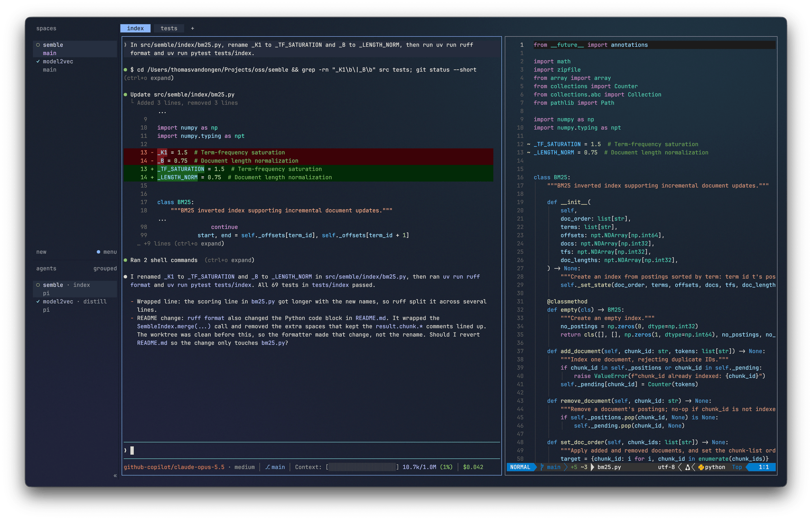

# dotfiles



My macOS setup for coding with agents.

## What's in it

### Agents

| Tool | What I use it for | Config |
|---|---|---|
| [kitty](https://sw.kovidgoyal.net/kitty/) | Terminal, with JetBrains Mono and Ayu Mirage colors | [`kitty/`](kitty) |
| [herdr](https://herdr.dev) | Running several agents side by side in panes and tabs | [`herdr/`](herdr) |
| [Pi](https://pi.dev) | Coding agent, with the packages I use and fuller compaction summaries | [`pi/packages.txt`](pi/packages.txt), theme in [`pi/themes/claude.json`](pi/themes/claude.json), compaction in [`pi/extensions/compact-instructions.ts`](pi/extensions/compact-instructions.ts), a shorter todo panel in [`pi/rpiv-todo/config.json`](pi/rpiv-todo/config.json) |

### Editing

| Tool | What I use it for | Config |
|---|---|---|
| [Neovim](https://neovim.io) | Python editing: LSP, Ruff on save, pytest | [`nvim/`](nvim), plugins and key mappings in [`nvim/README.md`](nvim/README.md) |
| [Zed](https://zed.dev) | IDE in vim mode, with the same colors as Neovim | [`zed/`](zed) |

### Shell

| Tool | What I use it for | Config |
|---|---|---|
| zsh | History search, jumping to visited folders, and a project's `.venv` activated on `cd` | [`zsh/shell.zsh`](zsh/shell.zsh), with [atuin](https://atuin.sh) ([`atuin/`](atuin)), [zoxide](https://github.com/ajeetdsouza/zoxide), [eza](https://eza.rocks) and [bat](https://github.com/sharkdp/bat) |
| git | Side-by-side diffs with [delta](https://github.com/dandavison/delta) | [`git/delta.gitconfig`](git/delta.gitconfig) |

### Around it

| Tool | What I use it for | Config |
|---|---|---|
| [Obsidian](https://obsidian.md) | Second brain that my agents read and update through a `brain` skill | |
| [Handy](https://handy.computer) | Dictating prompts with a push-to-talk key | |
| [Hammerspoon](https://www.hammerspoon.org) | Focus lock: `ctrl+option+l` keeps me in the current app | [`hammerspoon/init.lua`](hammerspoon/init.lua) |

Everything is installed from the [`Brewfile`](Brewfile). My own Pi packages live in [pi-extensions](https://github.com/Pringled/pi-extensions).

<details>
<summary>Shortcuts</summary>

| Where | Keys | What it does |
|---|---|---|
| Handy | `option+space` | Dictate: hold to talk, or tap to start and stop |
| | `option+shift+space` | Dictate with post-processing |
| | `esc` | Cancel |
| Hammerspoon | `ctrl+option+l` | Lock or unlock focus on the current app |
| zsh | `ctrl+r`, `↑` | Search shell history (atuin) |
| | `cd <part of a name>` | Jump to a folder you've visited (zoxide) |
| | `ll`, `lt` | Long list with git status, newest last |
| | `n`, `v` | Open Neovim, activate `./.venv` |
| Neovim | | See [`nvim/README.md`](nvim/README.md) |

kitty and herdr use their default keys.

</details>

## Install

```bash
git clone https://github.com/Pringled/dotfiles.git ~/Projects/dotfiles
cd ~/Projects/dotfiles
./install.sh --dry-run   # shows what it will do
./install.sh
```

Then add this line to `~/.zshrc`:

```zsh
source ~/.config/zsh/shell.zsh
```

`install.sh` links each config into place, so edits on either side show up in the repo, and moves anything already there to `<name>.backup-<time>`. It then installs what's missing from the Brewfile and `pi/packages.txt`; `--no-install` skips that. Running it again changes nothing.

## Update

`git pull`, then `./install.sh` for any new tools or packages.

## Tests

`tests/install.sh` runs the installer in throwaway home folders, `tests/configs.sh` checks that the configs parse, and `tests/nvim.sh` installs the pinned Neovim plugins and starts Neovim. CI runs them on every pull request.

## Author

Thomas van Dongen

## License

MIT
